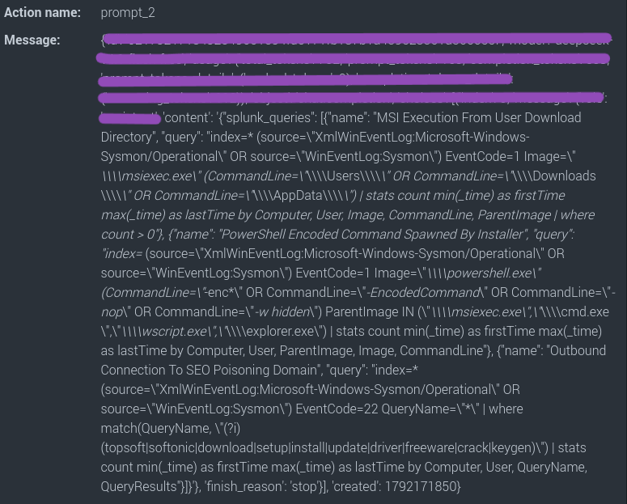
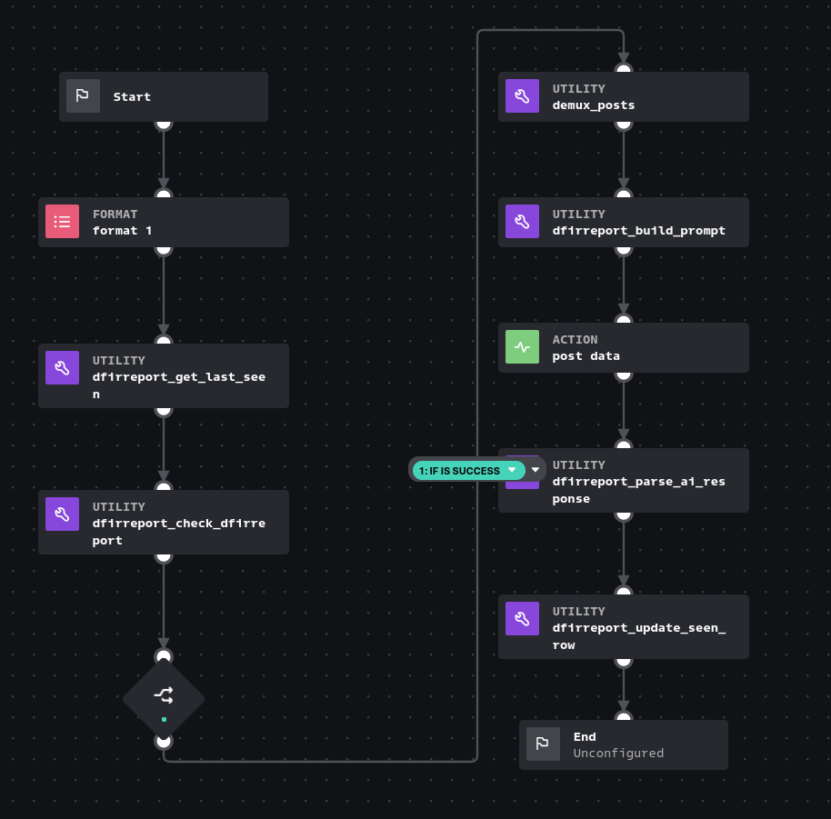

# تبدیل گزارش‌های DFIR به کوئری‌های Splunk


# مهندسی تشخیص تهدید با کمک هوش مصنوعی و Splunk SOAR

[English](./README.md) | [فارسی](./README.fa.md)

---

## معرفی پروژه

این پروژه، معماری کلی پیاده سازی "تبدیل گزارش‌های thedfirreport به کوئری اسپلانک" توسط ابزار Splunk SOAR است به این ترتیب که فید RSS سایت [The DFIR Report](https://thedfirreport.com/) را بررسی کرده، گزارش‌های جدید را شناسایی می‌کند و از یک مدل هوش مصنوعی می‌خواهد برای هر گزارش، کوئری‌های پیشنهادی Splunk را تولید کند. نتیجه در یک Custom List ذخیره می‌شود تا تحلیلگر بتواند آن را بررسی و پیگیری کند.



ایده اصلی، کوتاه‌تر کردن فاصله بین مطالعه یک گزارش تهدید و آماده‌کردن پیش‌نویس اولیه برای Detection Engineering است. البته باید درنظر داشت که خروجی مدل، پیشنهاد اولیه محسوب می‌شود؛ نه Detection Rule اعتبارسنجی‌شده و یا کوئری آماده استفاده در محیط عملیاتی.

**این مخزن مستندات پروژه را نگه می‌دارد و شامل سورس کد Python یا بسته قابل نصب Splunk SOAR نیست.** در اینجا معماری، تنظیمات، ساختار داده‌ها و نکته‌های فنی پیاده‌سازی ثبت شده‌اند.

## این معماری به چه صورت است؟




اگر قرار باشد تعیین کنیم که هنگام اجرای Playbook برای بار اول تا چند پست آخر بررسی شود، می‌توان در ابتدا یک بلاک از نوع Format ساخت و عدد مورد نظر را در آن تعیین کرد. بلاک بعدی یک Custom Function (که از این به بعد CF گفته میشود) با نام dfirreport_get_last_seen خواهد بود که آخرین url و title را به بلاک بعدی ارسال می‌کند. بلاک بعدی از نوع CF با نام dfirreport_check_dfirreport سایت dfirreport را جهت بررسی آخرین پست‌ها پیشمایش و اگر پست جدیدی وجود داشته باشد url, Title و تعداد پست‌های جدید را در خروجی ارسال می‌کند. سپس یک بلاک از نوع Decision اگر تعداد پست‌ها بیش از 0 باشد، خروجی بلاک قبل را به بلاک بعدی از نوع CF با نام  Demux_posts ارسال می‌کند. این بلاک برای آماده کردن تعداد بیش از 1 پست جهت ارسال به AI طراحی شده تا درخواست‌ها را یک به یک (نه همزمان) ارسال و نتیجه هر کدام را بطور جداگانه parse کند. بلاک بعدی از نوع CF با نام dfirreport_build_prompt جهت قراردادن لینک و تیتر در prompt از پیش نوشته شده است. متن Prompt چنین خواهد بود:

```
    prompt_text = (
    f"Threat report: {title}\n"
    f"URL: {url}\n\n"
    "IMPORTANT: Do NOT use any tools, do NOT run commands or fetch URLs. "
    "Answer directly from your own knowledge.\n"
    "Generate 3 Splunk detection queries for this threat. "
    'Return ONLY valid JSON, no explanation: '
    '{"splunk_queries": [{"name": "short name", "query": "index=* ..."}]}'
  )
```

پس از آن، prompt آماده شده با استفاده از action block از نوع http (که با AI API ارتباط دارد) به AI ارسال می‌شود و جواب آن از طریق بلاک بعدی از نوع CF با نام dfirreport_parse_ai_response بررسی و کوئری‌های درخواست داده شده استخراج خواهند شد. سپس بلاک بعدی از نوع CF و با نام  dfirreport_update_seen_row مقادیر title, url, queries در Custom List ذخیره می‌شود.
از این بخش به بعد را می‌توان با استفاده از action block از نوع SMTP، کوئری‌ها را ایمیل و یا با استفاده از بلاک از نوع prompt، آن را به متخصص موردنظر اطلاع داد.

## شرحی از Custom Functionها

<div dir="rtl" align="right">

| تابع | وظیفه |
|---|---|
| `dfirreport_get_last_seen` | خواندن وضعیت فعلی Custom List | 
| `dfirreport_check_dfirreport` | دریافت RSS و برگرداندن گزارش‌های جدید | 
| `dfirreport_demux_posts` | جداسازی گزارش‌ها؛ یک خروجی برای هر گزارش | 
| `dfirreport_build_prompt` | ساخت prompt جهت ارسال به AI | 
| `dfirreport_parse_ai_response` | پردازش پاسخ مدل و استخراج کوئری‌ها | 
| `dfirreport_update_seen_row` | ثبت یا به‌روزرسانی اطلاعات یک URL | 


نام‌ها مطابق نام‌گذاری استفاده‌شده در پیاده‌سازی هستند. کد این توابع در مخزن منتشر نشده است.
</div>


## ساختار Custom List

نام لیست:
<div dir="rtl" align="right">
`dfirreport_seen_posts`

| ستون | کاربرد |
|---|---|
| `url` | آدرس گزارش |
| `title` | عنوان گزارش |
| `splunk_queries` | کوئری‌های پیشنهادی تولیدشده برای گزارش |

ردیف اول لیست، header است و باید شامل `url`، `title` و `splunk_queries` باشد. این ردیف هنگام خواندن باید از پردازش داده‌ها کنار گذاشته شود و هنگام بازنویسی لیست حفظ شود.
</div>

## راه‌اندازی و پیکربندی

این بخش تنظیمات لازم برای ساخت Playbook را توضیح می‌دهد. از آنجا که سورس کد توابع منتشر نشده است، این مستندات به‌تنهایی برای نصب یا اجرای مستقیم پروژه کافی نیستند.

### ۱. پیش‌نیازها
<div dir="rtl" align="right">
  
- ابزار Splunk SOAR با دسترسی لازم برای ساخت Custom Function و Playbook
- یک HTTP asset برای ارتباط با endpoint سازگار با OpenAI API
- دسترسی شبکه به endpoint مدل و API key معتبر
- دسترسی به فید RSS سایت The DFIR Report
- یک Custom List برای نگهداری گزارش‌ها و خروجی‌ها
</div>

### ۲. ساخت Custom List

در SOAR میبایست یک Custom List با نام `dfirreport_seen_posts` با ستون‌های زیر ساخته شود:

- `url`
- `title`
- `splunk_queries`

ردیف اول باید نام همین ستون‌ها را داشته باشد.


### ۳. ساخت HTTP asset

یک HTTP asset جهت ارتباط با AI API

- **Base URL:** آدرس AI API Base
- **Headers:**
  - `Authorization: Bearer <api-key>`
  - `Content-Type: application/json`


### ۴. زمان‌بندی

برای اجرای خودکار، می‌توان از App یا ابزار Scheduler یا Timer استفاده کرد.

## نکته‌های فنی و درس‌های آموخته‌شده

### پاسخ مدل همیشه متن قابل استفاده ندارد

در استفاده از endpointها، ممکن است پاسخ شامل `tool_calls` باشد، در حالی که فیلد `content` خالی است. اگر مدل و endpoint از آن پشتیبانی می‌کنند، می‌توان `tool_choice: "none"` را در request تنظیم کرد و در prompt نیز صریحاً از مدل خواست که از ابزار استفاده نکند.


## امنیت و مدیریت خطا

- **ورودی غیرقابل‌اعتماد:** محتوای گزارش‌های خارجی را داده غیرقابل‌اعتماد در نظر بگیرید. متن گزارش نباید بتواند دستورالعمل‌های موردنظر برای مدل را تغییر دهد یا باعث شود مدل از محدودیت‌های تعریف‌شده خارج شود.
- **اعتبارسنجی کوئری‌ها:** پیش از اجرا، صحت SPL، منطق تشخیص، محدوده جست‌وجو و سازگاری کوئری با داده‌های موجود را بررسی کنید.
- **محدودسازی دسترسی:** دسترسی به HTTP asset، endpoint مدل و Custom List باید متناسب با نیاز محدود شود.
- **خطاهای ارتباطی:** خطاهای HTTP، timeout، پاسخ ناقص، JSON نامعتبر و پاسخ بدون محتوای قابل استفاده باید جداگانه بررسی شوند. شکست درخواست نباید به‌عنوان تولید موفق کوئری ثبت شود.
- **کنترل کیفیت خروجی:** تولیدشدن کوئری به معنی صحیح‌بودن آن نیست. هر کوئری باید از نظر syntax، منطق تشخیص، پوشش داده و کارایی بررسی شود.
- **ثبت وضعیت پردازش:** وضعیت دریافت گزارش، پاسخ مدل و ثبت خروجی را بررسی کنید تا مشخص باشد پردازش هر گزارش تا کدام مرحله پیش رفته است (Logging).
